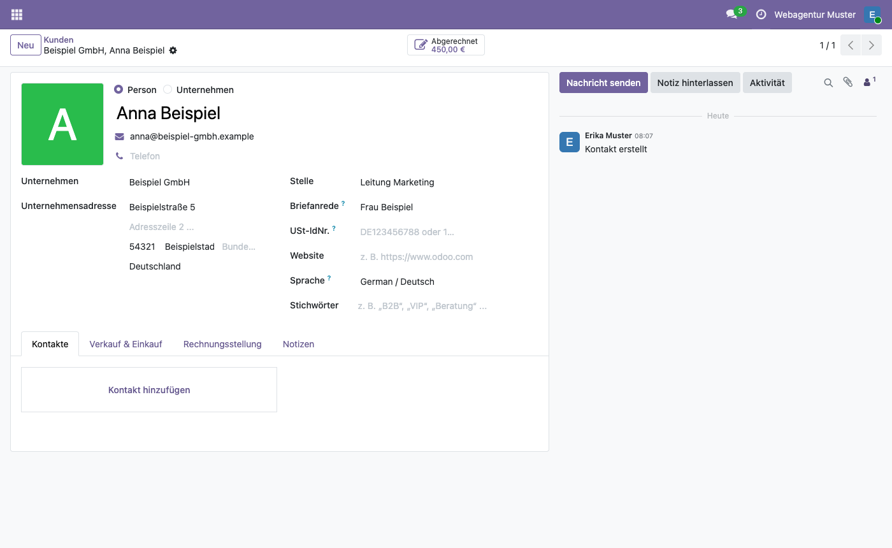
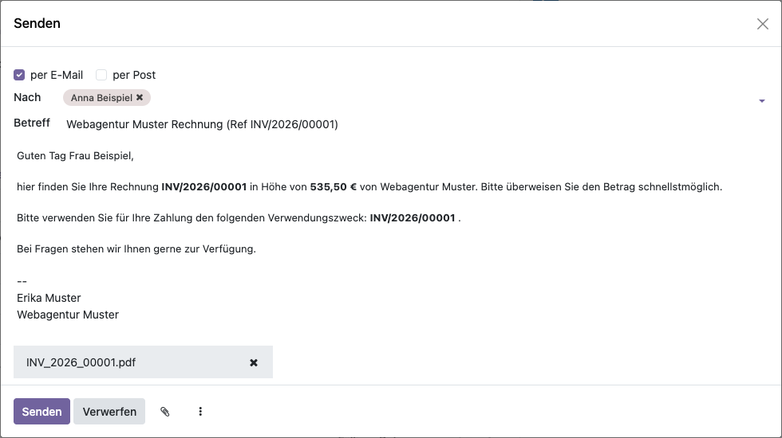

# Briefanrede für Odoo
<!-- /!\ Non OCA Context : Set here the badge of your runbot / runboat instance. -->

<!-- /!\ Non OCA Context : Set here the badge of your translation instance. -->

<!-- /!\ do not modify above this line -->

Ein Feld *Briefanrede* am Kontakt („Frau Muster“, „Herr Dr. Meier“) und die passende
Grußzeile in der Sprache der Mail – in den Rechnungs- und Gutschriftmails sofort, in
anderen Vorlagen auf Wunsch.

> **Alpha:** So beginnen die Rechnungsmails der Baumgärtner Marketing GmbH seit September
> 2026, als Modul ist es neu. Die Software wird ohne Gewährleistung bereitgestellt
> (AGPL-3.0, Abschnitte 15 und 16).

## Was das Modul tut

- Mit Briefanrede: „Guten Tag Frau Muster,“, englisch „Dear Frau Muster,“, französisch
  „Bonjour Frau Muster,“.
- Ohne Briefanrede: Personen mit ihrem Namen („Guten Tag Anna Beispiel,“), Firmen und Adressen
  wie eine Rechnungsadresse allgemein („Guten Tag,“ bzw. „Dear Sir or Madam,“).
- Die Rechnungs- und die Gutschriftmail beginnen nach der Installation in allen Sprachen
  mit dieser Grußzeile. Im Standard von Odoo 19 stünde dort „Guten Tag Anna Beispiel
  (Muster GmbH),“ oder der Name einer Rechnungsadresse.
- Bei der Deinstallation kommt die ursprüngliche Begrüßung zurück.

## Einrichtung

- Die Briefanrede am Kontakt neben der Position eintragen; Kontakte ohne Briefanrede
  brauchen nichts.
- Andere Mailvorlagen können die Grußzeile ebenfalls nutzen:
  `<t t-out="object.partner_id.letter_greeting"/>` statt der eigenen Begrüßung.

## Grenzen

- Nur Deutsch, Englisch und Französisch; andere Sprachen bekommen die englische
  Grußzeile.
- Eine schon geänderte Rechnungs- oder Gutschriftmail, deren erster Absatz nicht mit
  Odoos Begrüßung beginnt, bleibt unverändert.

## Mehr Dokumentation

Die Beschreibung des Moduls (englisch) steht in
[partner_letter_salutation/README.rst](partner_letter_salutation/README.rst).

*English: A letter salutation on the contact („Frau Muster“) and the matching greeting line
in the language of the mail, used by the invoice and credit note mails. Alpha, no
warranty.*

<!-- /!\ do not modify below this line -->

<!-- prettier-ignore-start -->

[//]: # (addons)

Available addons
----------------
addon | version | maintainers | summary
--- | --- | --- | ---
[partner_letter_salutation](partner_letter_salutation/) | 19.0.1.0.0 |  | Salutation on the contact and the matching greeting in the invoice and credit note mails

[//]: # (end addons)

<!-- prettier-ignore-end -->

## Licenses

This repository is licensed under [AGPL-3.0](LICENSE).

However, each module can have a totally different license, as long as they adhere to Baumgärtner Marketing GmbH
policy. Consult each module's `__manifest__.py` file, which contains a `license` key
that explains its license.

----
<!-- /!\ Non OCA Context : Set here the full description of your organization. -->
