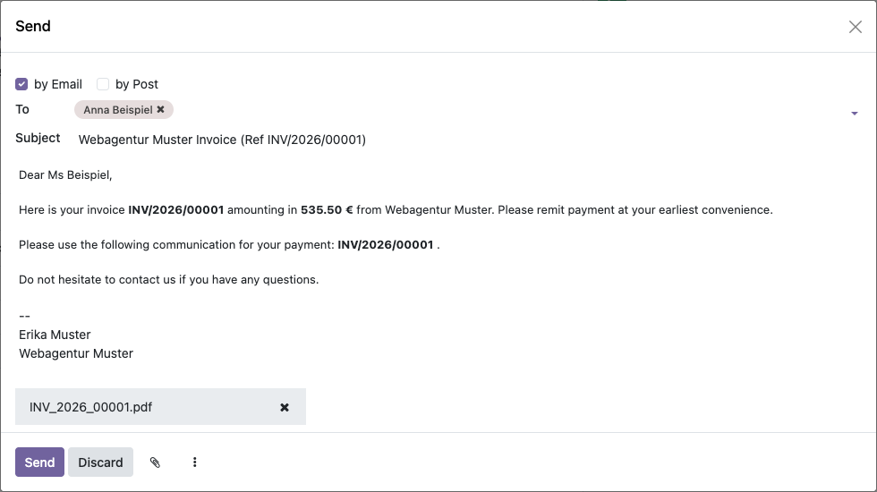

=================
Letter Salutation
=================

.. 
   !!!!!!!!!!!!!!!!!!!!!!!!!!!!!!!!!!!!!!!!!!!!!!!!!!!!
   !! This file is generated by oca-gen-addon-readme !!
   !! changes will be overwritten.                   !!
   !!!!!!!!!!!!!!!!!!!!!!!!!!!!!!!!!!!!!!!!!!!!!!!!!!!!
   !! source digest: sha256:fd9188bddaa1e2a90f5c0e0a6ea1d3705b0db27589c0373cb67561c551bfb84e
   !!!!!!!!!!!!!!!!!!!!!!!!!!!!!!!!!!!!!!!!!!!!!!!!!!!!

.. |badge1| image:: https://img.shields.io/badge/maturity-Alpha-red.png
    :target: https://odoo-community.org/page/development-status
    :alt: Alpha
.. |badge2| image:: https://img.shields.io/badge/license-AGPL--3-blue.png
    :target: http://www.gnu.org/licenses/agpl-3.0-standalone.html
    :alt: License: AGPL-3
.. |badge3| image:: https://img.shields.io/badge/github-BM1--de%2Fodoo--partner--salutation-lightgray.png?logo=github
    :target: https://github.com/BM1-de/odoo-partner-salutation/tree/20.0/partner_letter_salutation
    :alt: BM1-de/odoo-partner-salutation

|badge1| |badge2| |badge3|

Adds the field *Letter Salutation* to the contact, for example „Frau
Muster“ or „Herr Dr. Meier“, and a greeting line computed from it in the
language of the mail:

- with a salutation: „Guten Tag Frau Muster,“, „Dear Frau Muster,“ or
  „Bonjour Frau Muster,“;
- without one, a contact person of a company or organisation (a contact
  of the type „Contact“ below another contact) by their name: „Guten Tag
  Anna Beispiel,“;
- every other contact without a salutation in general terms: „Guten
  Tag,“, „Dear Sir or Madam,“ or „Bonjour,“. These are companies,
  contacts without a parent contact such as an association or a private
  customer, and addresses such as an invoice address.

Odoo 20 has neither a switch between person and company nor first and
last names, and counts every contact without a tax ID as a person, also
an association or a public body. Whether a name is the name of a person,
it cannot tell; only a contact person below another contact is surely
one.

Odoo has no title field on contacts any more, and its invoice mail
starts with „Dear Anna Beispiel (Muster GmbH),“, or with the name of an
invoice address. On installation, the invoice and the credit note mail
use the new greeting line instead, in every language; uninstalling puts
the original greeting back.

.. IMPORTANT::
   This is an alpha version, the data model and design can change at any time without warning.
   Only for development or testing purpose, do not use in production.
   `More details on development status <https://odoo-community.org/page/development-status>`_

**Table of contents**

.. contents::
   :local:

Configuration
=============

Enter the salutation on the contact, next to the job position. Contact
persons of a company, companies and invoice addresses need none; a
private customer without a parent contact needs one to be greeted
personally.

Other mail templates can use the greeting line as well, with
``<t t-out="object.partner_id.letter_greeting"/>`` instead of their own
greeting.

Usage
=====

Send invoices and credit notes as usual: the mail starts with the
greeting line of the invoice address, in the language of the mail.

|The greeting line in the invoice mail|

The screenshot was taken with Odoo 19; the greeting line is the same in
Odoo 20.

Known issues / Roadmap
======================

- Only German, English and French; other languages get the English
  greeting.
- An invoice or credit note mail whose first paragraph does not start
  with Odoo's greeting is left unchanged.
- A private customer without a parent contact gets the general greeting,
  as Odoo 20 cannot tell a person from an association by its name. Enter
  a salutation, for example „Frau Beispiel“, to greet such a contact
  personally.

Changelog
=========

20.0.1.0.0 (2026-11-19)
-----------------------

- Migration to Odoo 20.
- Odoo 20 has no switch between person and company any more and counts a
  contact without a tax ID as a person. Without a salutation, only a
  contact person below another contact is greeted by their name now;
  every contact without a parent contact gets the general greeting, also
  an association or a private customer without a tax ID („Guten Tag,“
  instead of „Guten Tag Sportverein Musterstadt,“). A salutation greets
  such a contact personally.

19.0.1.0.0
----------

- First version for Odoo 19, built on the salutation that Baumgärtner
  Marketing GmbH has used in its invoice mails since September 2026.

Bug Tracker
===========

Bugs are tracked on `GitHub Issues <https://github.com/BM1-de/odoo-partner-salutation/issues>`_.
In case of trouble, please check there if your issue has already been reported.
If you spotted it first, help us to smash it by providing a detailed and welcomed
`feedback <https://github.com/BM1-de/odoo-partner-salutation/issues/new?body=module:%20partner_letter_salutation%0Aversion:%2020.0%0A%0A**Steps%20to%20reproduce**%0A-%20...%0A%0A**Current%20behavior**%0A%0A**Expected%20behavior**>`_.

Do not contact contributors directly about support or help with technical issues.

Credits
=======

Authors
-------

* Baumgärtner Marketing GmbH

Contributors
------------

- Phillip Baumgärtner baumgaertner@bm1.de

Maintainers
-----------

.. |maintainer-bm1-phillip| image:: https://github.com/bm1-phillip.png?size=40px
    :target: https://github.com/bm1-phillip
    :alt: bm1-phillip

Current maintainer:

|maintainer-bm1-phillip| 

This module is part of the `BM1-de/odoo-partner-salutation <https://github.com/BM1-de/odoo-partner-salutation/tree/20.0/partner_letter_salutation>`_ project on GitHub.

You are welcome to contribute.
