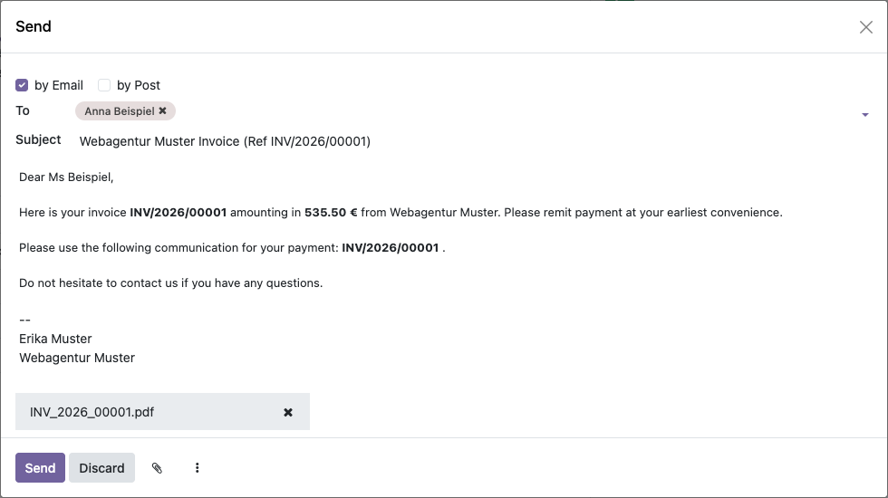

Send invoices and credit notes as usual: the mail starts with the greeting
line of the invoice address, in the language of the mail.

The screenshot was taken with Odoo 19; the greeting line is the same in Odoo 20.
